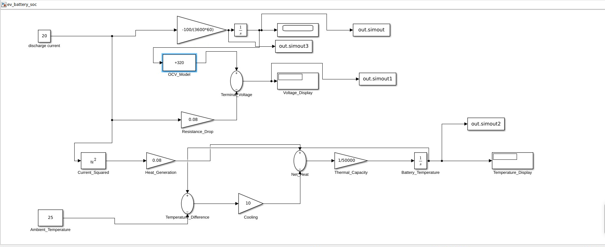

# CAN-Based Digital Twin for EV Battery Monitoring and Fault Detection

### MATLAB/Simulink | Python | CAN-Bus | Battery Management Systems (BMS)

**Project Status: In Development**

## 1. Project Overview

This project develops a simulation-based Digital Twin for monitoring electric vehicle battery parameters through CAN-Bus communication.

The objective is to combine MATLAB/Simulink battery modeling with Python-based CAN communication, battery diagnostics, and visualization.

The project is developed incrementally as an automotive engineering portfolio project.

## 2. System Architecture

```text
MATLAB / Simulink
Battery Model
       |
       v
Battery Simulation CSV
       |
       v
CAN Encoding (python-can + cantools)
       |
       v
Virtual CAN-Bus
       |
       v
CAN Decoding
       |
       v
Battery Digital Twin
       |
       +---- SQLite Database
       |
       +---- Fault Detection
       |
       +---- Streamlit Dashboard
```

The CAN encoding, decoding, database, and dashboard stages are being developed incrementally.

## 3. MATLAB/Simulink Battery Model

The battery model implements:

- State of Charge (SOC) estimation using coulomb counting
- Simplified battery terminal voltage estimation
- Thermal behavior using resistive heating and cooling
- Simulation data export at 1 Hz

### Simulink Model Screenshot



## 4. Simulation Parameters

| Parameter | Value |
|---|---|
| Nominal battery voltage | 400 V |
| Battery capacity | 60 Ah |
| Initial SOC | 80% |
| Discharge current | 20 A |
| Internal resistance | 0.08 Ω |
| Initial temperature | 25 °C |
| Simulation duration | 600 seconds |
| Sampling frequency | 1 Hz |

## 5. Simulation Results

| Battery Parameter | Initial | Final |
|---|---|---|
| SOC | 80% | 74.44% |
| Voltage | 398.4 V | 392.84 V |
| Temperature | 25 °C | Approximately 25.36 °C |
| Current | 20 A | 20 A |

The model generates 601 simulated measurements stored in `data/battery_simulation.csv`.

## 6. Technologies

**Implemented:** MATLAB, Simulink, Python, pandas, NumPy, and initial virtual CAN communication.

**In development:** python-can, cantools, DBC-based CAN communication, SQLite, Streamlit, and Plotly.

**Optional future integration:** Vector CANoe and CAN hardware interfaces.

## 7. Development Roadmap

- [x] MATLAB/Simulink battery model
- [x] SOC estimation
- [x] Battery voltage simulation
- [x] Thermal model
- [x] Export simulated battery measurements
- [x] Initial Python virtual CAN test
- [ ] DBC-based CAN message encoding and decoding
- [ ] SQLite battery time-series storage
- [ ] Rule-based battery fault detection
- [ ] Digital Twin monitoring dashboard
- [ ] Automated testing and technical report
- [ ] Optional CANoe and hardware integration

## 8. Repository Structure

```text
can-battery-digital-twin/
├── simulink/
│   ├── ev_battery_soc.slx
│   └── README.md
├── data/
│   ├── battery_simulation.csv
│   └── README.md
├── images/
│   ├── Simulink_battery_model.PNG
│   └── README.md
└── README.md
```

## 9. Engineering Disclaimer

All battery data is simulated using simplified mathematical assumptions. The model is intended for educational development and demonstration and has not been validated for real-world automotive or safety-critical applications.
